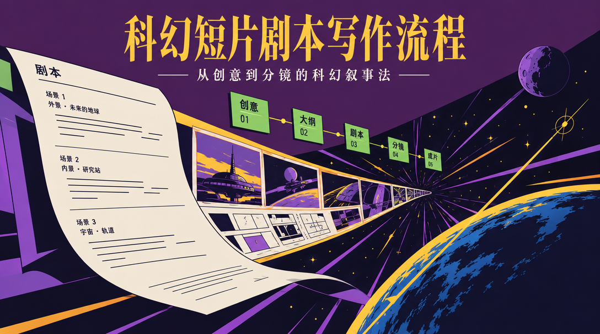

# domn-film-scifi-short-film



> 把一句模糊的科幻脑洞，按 8 步纪律变成「只承载一个点子+一次反转、且奇观零成本」的可拍短片剧本。

## 真实产出样例

下面是这个技能**实际会产出**的东西（抽自仓库内的 references/ 真实交付样例），不是抽象描述：

```text
一句话公式：如果把"数字遗物整理"推到极限，那么逝者会变成能回话的代理，而整理师自己也可能是其中一个。
最后 10 秒（全片地基）：
他关掉工作台。屏幕暗下去的一瞬，反光里映出一行没来得及关的日志："代理：阿哲 维护人：父亲 起始日期：八年前"
视觉母题：屏幕暗下去时的反光——①常态：反光里是他的脸；②异常：多了一个人轮廓；③变义：反光里是那行日志。
5 维评分：塌架5｜自洽4｜奇观3｜颠覆5｜共鸣5 = 22，加分单场景单日+2、末10秒可视觉化反转+2、奇观低成本+2 → 28/31 通过
```

## 是什么

把一句模糊的科幻脑洞，按 8 步纪律变成「只承载一个点子+一次反转、且奇观零成本」的可拍短片剧本。 本仓库是一个 Agent 技能（SKILL.md 为唯一权威定义），把上面的方法论沉淀为可被对话触发的可执行流程。

## 为什么不同

用「点子发生器」(10 原料库×12 算子，只许同源叠加) + 「双向测试」(塌架测试向内、情感独立测试向外) 强制筛掉伪科幻；并强制先写最后 10 秒再倒推。

## 怎么做（工作流）

<p align="center">
  
</p>

> 先写最后 10 秒；反转必须画面能说清

1. **锁约束** — 定时长/拍摄方式/调性(默认 5 分钟·AIGC·暖)
2. **一句话公式** — 写成“如果把___推到极限，那么___”
3. **发生器跑点子** — 3 原料各套 4 算子，只写不评
4. **双向测试** — 塌架必塌、情感必立，5 维<17 淘汰
5. **写末 10 秒** — 画面能说清、母题变义、给更大问题
6. **倒推填拍** — 按 3/5/8 拍模板，守“不解释设定”

## 怎么用

将本仓库放入支持 `SKILL.md` 的 Agent 技能目录：

- **WorkBuddy**：`~/.workbuddy/skills/domn-film-scifi-short-film/`
- **Codex / 其他**：对应 skills 目录

然后在对话中触发，例如：

```
用 domn-film-scifi-short-film 把'外卖员每次送餐都会穿越到对方记忆'变成 5 分钟 AIGC 短片企划。
```

## 依赖

纯提示词方法论 + references/ 弹药库；生视频依赖文生视频模型（即梦 Seedance / Kling / 可灵等），提示词喂给这些模型执行。

## 仓库结构

```
domn-film-scifi-short-film/
├── SKILL.md                 # 技能定义（唯一权威）
├── assets/                  # 模板 / 占位素材
├── references/              # 方法论弹药库
└── assets/readme/           # 本 README 的视觉资产（hero.webp / workflow.svg）
```

## 许可

本仓库内容以 `SKILL.md` 为唯一权威定义。如附带 `LICENSE` 文件，以其为准。

---

*README 由 `beautify-github-readme` 生成 · 封面图来自作者作品集，强调色由封面采样派生；工作流图为每技能独立 motif。*